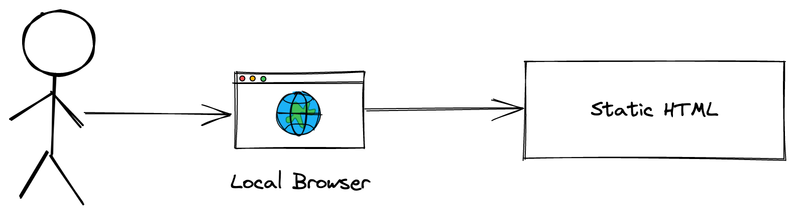
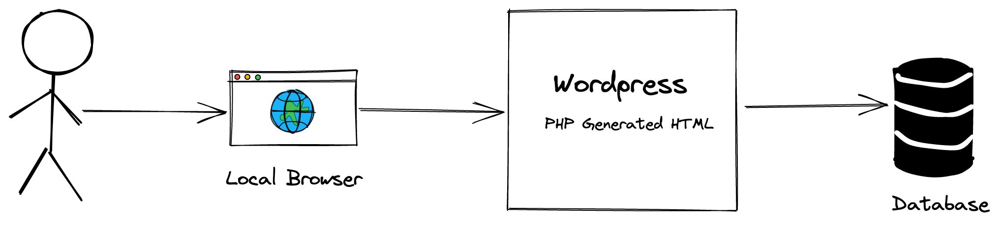
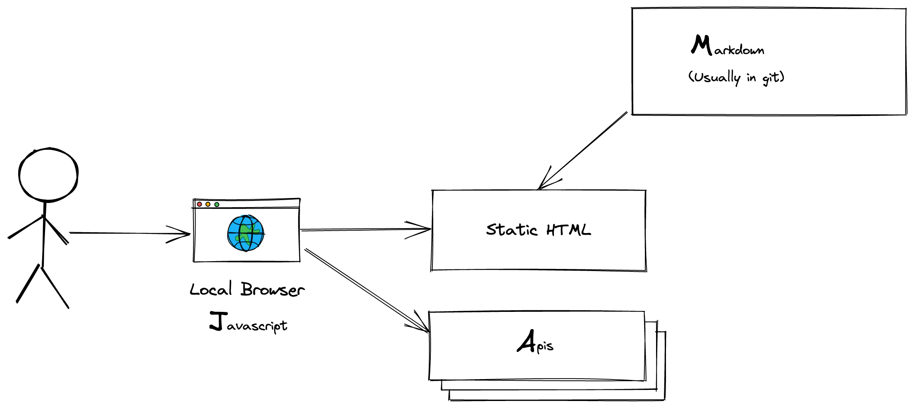

## Wordpress to Jamstack

 [Steve Miller](https://www.r15cookie.com)

- Devops Practioner
- Sr. DevOps Engineer at Tuition.io

Note:

GOAL: 30 minutes presentation, with 15-30 minute Q&A

- Introduction of myself
  - Sr. DevOps Engineer at Tuition.io
  - Multiple other Devops and System Admin roles across a variety of private and public institutions
  - Passion for Robust Architectures
  - Overall Background
    - Professionally: Systadmin -> DevOps (like to use all the fancy tools Developers use to manage Infrastructure)
    - Volunteer: Custom PHP framework, then over to Yii Framework (yes, CraftCMS seems SUPER cool at that point...)
    - Both: Several wordpress installations/management over the years
- Take questions throughout the presentation: **REPEAT QUESTIONS**

<!--s-->

## Goal

Discuss the Jamstack, and moving from Wordpress to a Jamstack site.

Note:

- Overall Goals: 
  - Discuss the architecture of a Jamstack site
  - Discuss motivations of why you may wish to move away from Wordpress
  - Various methods to do so, or to live with the best of all technologies.
- Background on Audience
  - How many current manage Wordpress Installation?
  - Use Git/Github/etc for Development?
  - Manage Cloud Resources? (which cloud, and what)
  - GRWebDev: What technologies?
    - Backend: Node, Rails, Python, PHP
    - Frontend: Pure JS, Angular, React, Vue, others? 
    - IDEs: VSCode...others? (vim joke perhaps)

<!--s-->

## The Web - Early History

Note:

- In the beginnging - just plain HTML, images, and a browser

<!--v-->

## The Web - Improvements

Note:

- Static HTML was a pain to maintain - and only the same thing shown to everyone
- So...let's have the web server dynamically build a site, using a database as a back end.
- All kinds of interesting things
  - Centralized templates across the site
  - User logins - and user based content based on that login!
  - Easy to maintain content for non-web adminstrators (not needing to give out tools like Dreamweaver...or (shudder to think) Frontpage)

<!--s-->
## Wordpress: What's the problem?

Note:

- PHP driving code for ALL pages
- Backed by a database
- Advantages: PHP rendering of all pages allows for easy, dynamic page generation, common template use, etc.

<!--v-->
## Wordpress: What's the problem?

- Operational Overhead
  - Security
  - Performance

Note:

- Common platform with lots of plugings: but
  - Security of platform itself.  Perhaps mention downsides of older platform, less then ideal separation of view, controller, and model code 
  - Plugins are common code exploits.  Link to recent, hihg profile plugin exploits...and plugins have **FULL** access to entire environment including
    - [Over 280,000](https://thehackernews.com/2022/09/over-280000-wordpress-sites-attacked.html)
- Performance
  - Without optimization, Database quer(ies) on each page hit.
    - Can optimize with Memcached for database queries, and possible front the entire site with a CDN
    - But such optimization introduce other layers that need management, and potential downtime risks.

<!--s-->

## A Solution: Jamstack

A modern approach to static websites:

Note:
- Wait...static websites!

- **J**avascript
- **A**PI
- **M**arkdown

- By wrapping static sites with modern frameworks, we can mitigate a LOT of the issues we see with standalong wordpress installs
- Security: Reduce exposure by JUST having the API exposed.  The rest of the site...just a static site!
  - Still have to be cautious of XSS, XSRF - but reduced surface area for verifying content, etc.
- Performance: Static sites!
  - Rendering is super-performance.  
  - Javascript...have to be cautious to not put too much processing on the front-end.
  - Caching is a lot easier - CDN for site, restful API could be run through CDN to cache GET requests if relevant.

  "There are only two hard things in Computer Science: cache invalidation and naming things.

-- Phil Karlton

<https://martinfowler.com/bliki/TwoHardThings.html>

<!--s-->

## Content - Where does it live

- Purely in Git
- Git Based Headless CMS
- Headless CMS

Note:

- Purely in Git
  - Can use pure development-like review processes
  - Kind of assumes website/HTML generated content
    - Although most SSG can generate JSON output as well, and that could potentially be consumed by apps for a more raw "content" approach
- Git Based Headless CMS: 
  - [Netlify CMS](https://www.netlifycms.org/)
  - [Forestry](https://forestry.io/)
- Headless CMS
  - [Payload CMS](https://payloadcms.com/) - July's GRWebDev Presentation
  - [Craft CMS](https://craftcms.com/) - August's GRWebDev Presentation
  - [Ghost CMS](https://ghost.org/)
- Headless CMS
  - Content lives in Database, rendered dynamically with API calls from Front-end
  - Allows for more full-features workflows, etc.
  - Upside:
    - More complex workflows
    - Dynamic data generation
  - Downsides
    - Dynamic code - so performance, security.

<!--v-->

# Netlify-CMS

Let non-technical users use a Git workflow for your website.

Note:

- Demo: Basic Netlify site leveraging Hugo and Netlify-CMS for content editing

<!--s-->
## Transition Strategies

- Writer/Editor Audience?
  - Technical: Pure HTML - Hosted in Git
  - Semi-Technical or Non-Technical: Markdown/Git Based Workflow
  - Non-Technical: Headless CMS

Note:

- Depends on where you want to go to.  And the audience that will be maintaining the content on the site.
- Dump static, load into JAMSTack
  - Pure HTML
  - Content itself in Markdown?
- Git based workflow
  - Web based Git Workflow: NetlifyCMS
- Convert to Markdown
  - WP to Hugo: https://github.com/SchumacherFM/wordpress-to-hugo-exporter
  - WP to Gatsby https://github.com/tinacms/wp-gatsby-markdown-exporter
- Headless CMS
  - Wordpress as Headless CMSes
  - Others such as Payload and Craft (see last two month's presentation for a deep conversation)

- Demo: Moving Wordpress Site over to Hugo 

<!--s-->

# Demo

- Netlify "Quick Demo"

<!--v-->

## Strategies we Avoided:

- Headless Wordpress

Note:

- Headless Wordpress - technically possible, but still retains a bit of the downsides of traditional wordpress

<!--s-->

## Additional Resources

- [The Jamstack Ecosystem vs. WordPress: Why and When to Switch](https://prismic.io/blog/jamstack-vs-wordpress)
- [Headless Wordpress](https://snipcart.com/blog/headless-wordpress)
- [Wordpress To JAMStack Options](https://github.com/remotesynth/Wordpress-to-JAMstack-Options)