<!-- .slide: data-background="./civo-fastfeedback/background.png" -->

## DevOps Bootcamp 2021: Fast Feedback

 [Steve Miller](https://www.r15cookie.com)

- Devops Practioner
- Sr. Software Engineer at Plex Systems (Not **that** Plex...)

Note:

GOAL: 50-60 minutes presentation, Q&A throughout session

- Introduction of myself
  - Sr. Software Engineer at Plex
  - Multiple other Devops and System Admin roles across a variety of company sizes as well as public institutions
  - Passion for DevOps Practices

<!--s-->

<!-- .slide: data-background="./civo-fastfeedback/background.png" -->

## Fast Feedback

- Journey So Far
  - Intro To DevOps
  - Docker
  - Build & Test
  - Release & Deploy
  - Operate & Monitor
- Demo of fast-feedback examples.

Notes:
  - So Far, covered
    - Build & Test
    - Release & Deploy
    - Operate & Monitor
  - Consistent Theme: "Fast Feedback"
  - Let's explore fast feedback in specific examples.
  - Assumption that we have an understanding of basic Docker and Kubernetes.

<!--s-->

<!-- .slide: data-background="./civo-fastfeedback/background.png" -->

## Fast Feedback

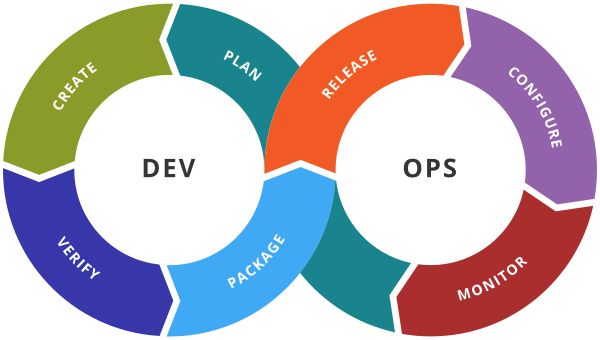 <!-- .element: class="img" style="max-width:300px"-->
- Build/Test - Fast Feedback to the Developer
- Release/Deploy - Fast Feedback to Peers
- Operate/Monitor - Fast Rollback 

Notes:

- Building an efficent Devops Toolchain in a continous journal - always be looking for improvements
- Going to highlight three areas of the Devops Toolchain for fast feedback techniques today
  - Create (Build/Test): Fast Feedback from a developer themself as they are working on a solution
  - Verify/Package (Release/Deploy): Fast Feedback from Peers and Business Users
  - Release/Configure/Monitor(Operate/Monitor): Fast Rollback once a change has made it to production
- Several tools will be highlighted
  - Help to solidify the ideas presented so far by seeing them in action

<!--s-->

<!-- .slide: data-background="./civo-fastfeedback/background.png" -->

## Fast Feedback: Microservice Focus

https://github.com/ssmiller25/cloudnativeapp

 <!-- .element: class="img" style="max-width:400px"-->

Notes:

Need an example app - so leveraging Google's "Online Boutique" store as an example Microservice app

- Microservices aren't required for fast feedback looks, but can be helpful in a lot of cases.
- Google's Microservice Reference Framework.
- A Polyglot app to provide great examples across the most commonly used languages (in Microservice Architectures)

<!--v-->

## Fast Feedback: Microservice Focus

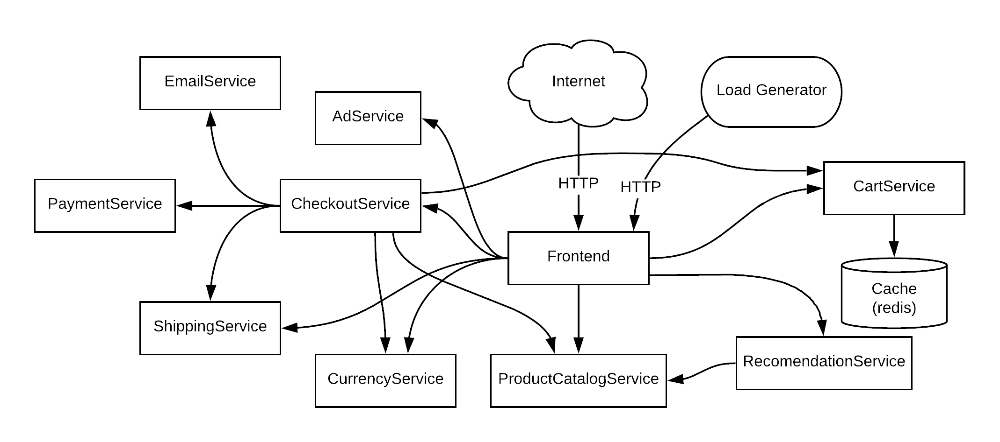

Notes:

- Why???
- Common microservice architecture
- Benefits as a demo
  - Show how a common web application, like a store, is broken up in a Microservice way
  - Services are implemented in Python, Go, Node.js, Java, and C# - so great references for your language of choice.
  - Use of gRPC thoughout (except for frontend of course)

<!--s-->

<!-- .slide: data-background="./civo-fastfeedback/background.png" -->

## Fast Feedback - Build and Test

Optimize the local developer experience

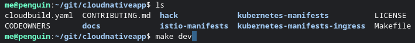

Notes:
- Developers sometimes have to deal with long, manual local build toolchains
- Make sure the local toolchain is optimized

<!--v-->

<!-- .slide: data-background="./civo-fastfeedback/background.png" -->

## Fast Feedback - Build and Test

Documentation

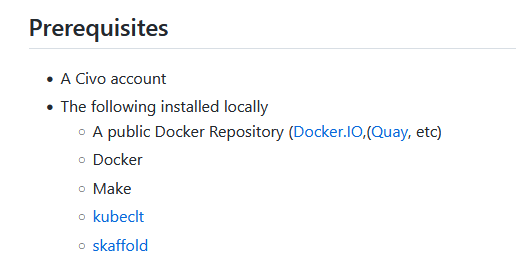  <!-- .element: class="img" style="max-width:400px"-->
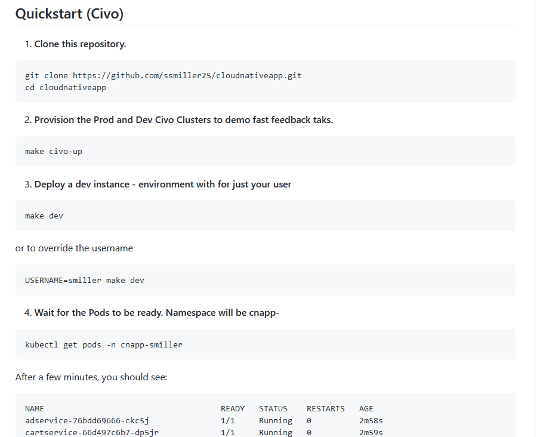  <!-- .element: class="img" style="max-width:400px"-->

Notes:

- Live Demo: https://github.com/ssmiller25/cloudnativeapp
  - Review README sections for "Pre-requisites" and "Quickstart (Civo)"
  - Highlights: Makefiles and skaffold
  - Makefile - a method to help consolidate series of commands.  Older, but common in some toolchains already (C/C++, Golang, etc)
  - Skaffold - A method to automate the building of multiple containers
  - Alternative to potentially research 
    - Tilt
    - DevSpace
    - Plain old makefiles/shell scripts :-)
- Make **sure** you have great docs so that developers can start from day 1
  - And no garantee **my** my docs are great...but always encourage newer developers to update docs as they find defincencies.

<!--v-->

<!-- .slide: data-background="./civo-fastfeedback/background.png" -->

## Fast Feedback - Build and Test

Make a change and bring up the local environment

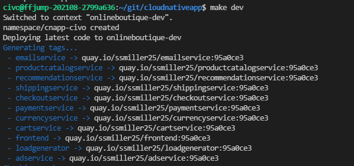  <!-- .element: class="img" style="max-width:600px"-->

Notes:
- Got a request to offer free shipping to everyone
- Well, developer decides to begin working on PR
  - Adjusts src/frontend/templates/header.html in online boutique to brag about free shipping
  - "Make Dev"
  - While working, look through Makefile to see how it's working
- Makefile
  - Does deploy to a civo cluster - but why?
    - Best to, as best as possible, align dev and prod environemnts to be AS CLOSE as possible.  (Primary use case for docker)
  - Nothing prevents one from using local kubernetes cluster for initial testing.  Highly dependent on your application.

<!--v-->

<!-- .slide: data-background="./civo-fastfeedback/background.png" -->

## Fast Feedback - Build and Test

Results from a local environment

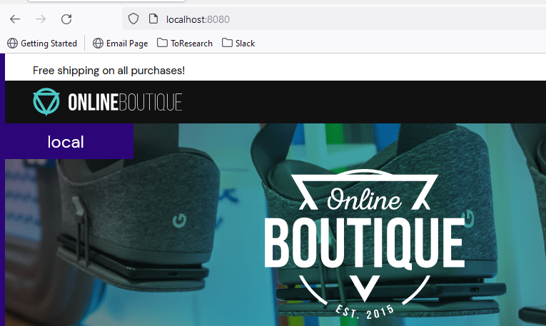  <!-- .element: class="img" style="max-width:600px"-->

Notes:
  - Live Demo: VSCode and make cnage locally (to src/frontend/templates/header.html)
  - While this is deployed to a cluster, not actually exposed to the outside world.  Leverage "kubectl port-forward" to gain access to the application.

<!--s-->

<!-- .slide: data-background="./civo-fastfeedback/background.png" -->

## Fast Feedback - Release/Deploy

Pull based review environments

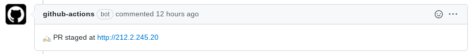

Notes:

- Once development is complete, should generally be peer reviewed, or potentially reviews by end users
- Pull based environments provide an amazing way to speed us such development
  - Let's users see yoru code change in an entirly "mini" deployment of your application.
  - Can give out credentials to end-users so they review without any special tooling/consideration
  - Can be leveraged in lots of ways - one-off environments for customer demos, etc, etc.  
- Keys
  - Build pipeline configured to spin up a new environment based on PR
  
- Hands-On Example
  - Show build pipeline in https://github.com/ssmiller25/cloudnativeapp/pull/1

<!--v-->

<!-- .slide: data-background="./civo-fastfeedback/background.png" -->

## Fast Feedback - Release/Deploy

Pull Request with the changes
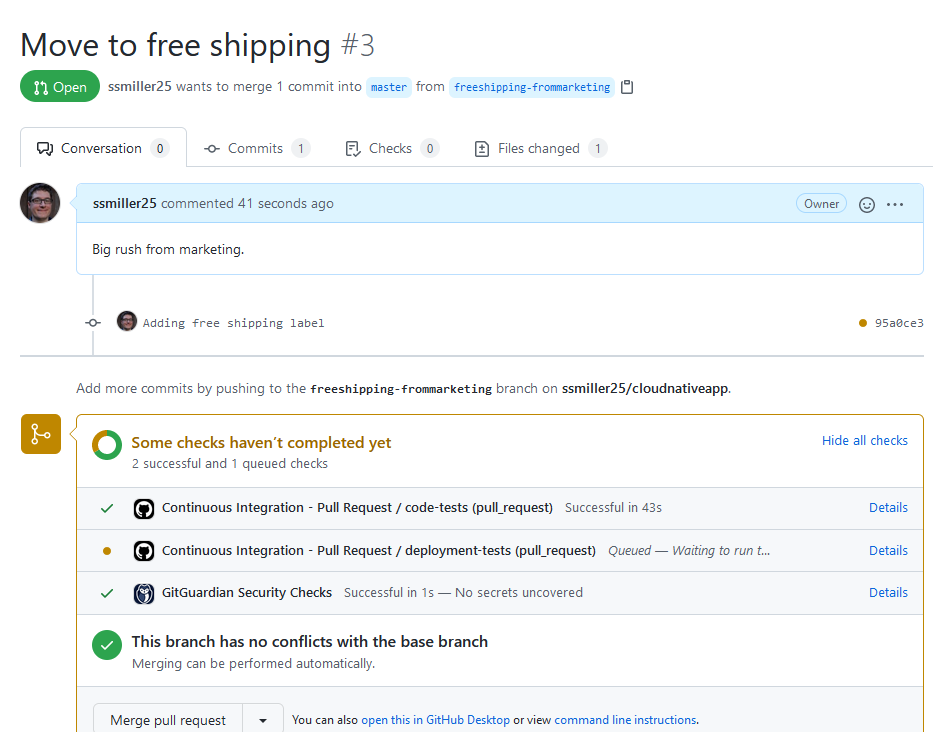  <!-- .element: class="img" style="max-width:600px"-->

Notes:
- Examples of a build pipeline.  This is using Github actions, but there are many local and cloud-hosted options avaiable (Jenkins, CircleCI, Tekton, etc.)
- Review .github/workflow for some examples
  - Review ci-pr.yaml
    - Point out some preliminary code unit tests are done first
    - The, deployment process is baked into the pipeline
      - Notice secrets - these are defined in a secure location on github.  **NEVER COMMIT SECRETS TO A REPOSITORY!**
  - Security - not a big deal with private repos for but PUBLIC, make sure your infrastrucutre pipeline doens't run for unknown individuals!  <https://docs.github.com/en/github/administering-a-repository/managing-repository-settings/disabling-or-limiting-github-actions-for-a-repository#configuring-required-approval-for-workflows-from-public-forks>
  - This particular pipeline takes about 13 minutes (yes, not **rapid**, but a lot of testing is still baked into this pipeline).  Generally a tradeoff for how fast you want the pipeline to run, versus how many and what kinds of tests you wish to run.
    

<!--v-->

<!-- .slide: data-background="./civo-fastfeedback/background.png" -->

## Fast Feedback - Release/Deploy

Preview environment available

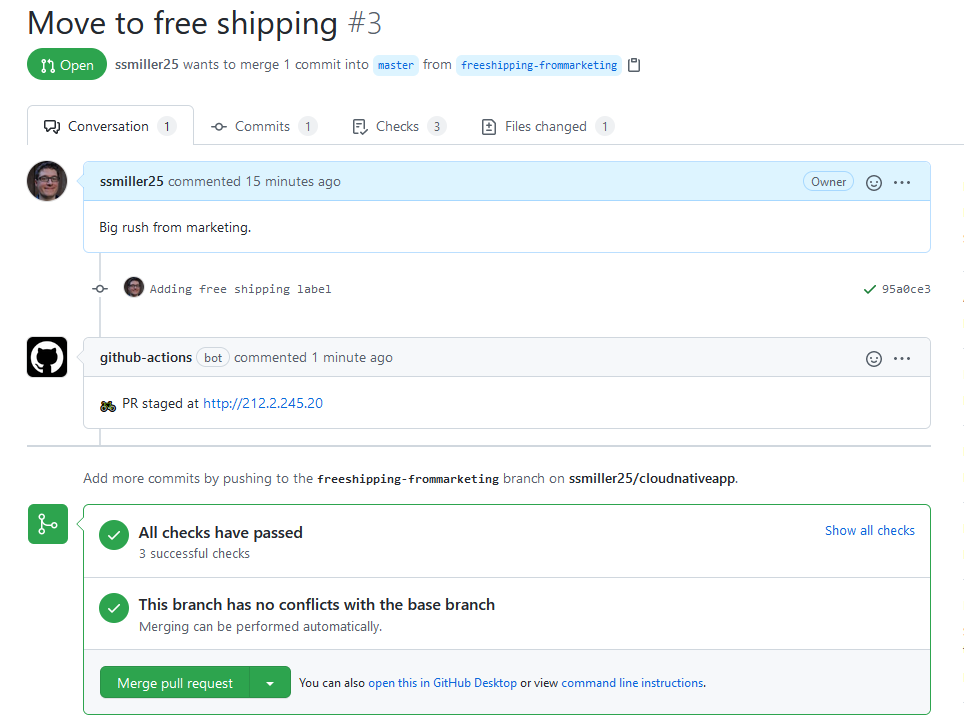 <!-- .element: class="img" style="max-width:400px"-->
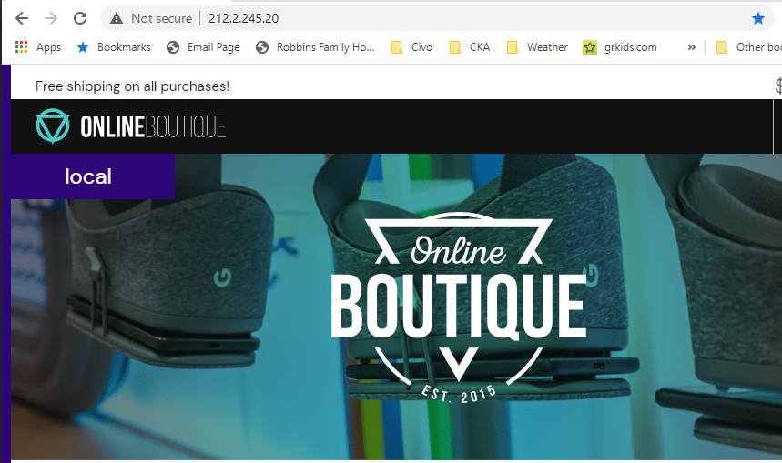 <!-- .element: class="img" style="max-width:400px"-->

Notes:
- PR is now ready
- URL is available and can be used by other developers, or business users, to review the upcoming code changes
- Some considerations
  - May need to bake in more security, depending on yoru application (extra logins, client-side certificate requirements, etc)
  - How to obtain feedback from end users.  Maybe a quick review of how to perform Github comments.  Or potentially take their feedback via an external system

<!--v-->

<!-- .slide: data-background="./civo-fastfeedback/background.png" -->

## Fast Feedback - Release/Deploy

Merge into the main branch

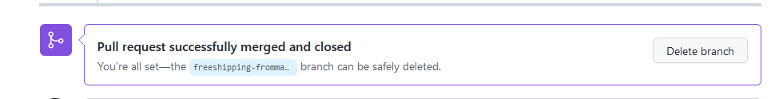 <!-- .element: class="img" style="max-width:400px"-->
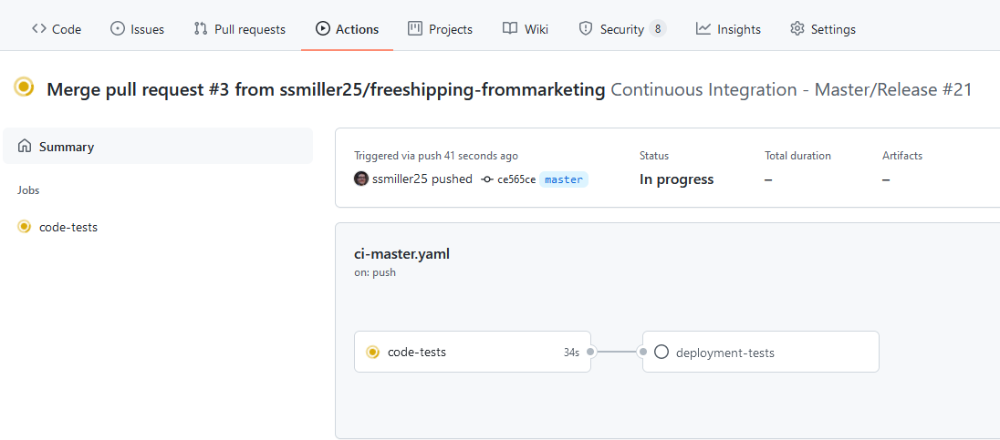 <!-- .element: class="img" style="max-width:400px"-->

Notes:
- Once PR has the appropriate approvals, merge in
- Another pipeline starts to deploy to production
- Review ci-master.yaml
- Also some notes
  - Generally a cleanup pipeline would remove PR environments once they are no longer used.  Disabled for presentation purposes.

<!--s-->

<!-- .slide: data-background="./civo-fastfeedback/background.png" -->

## Fast Feedback - Operate/Monitor

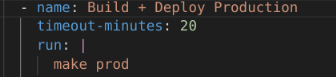

Rollback on demand

Notes:

- Monitoring is pretty well covered, and is a larger subject - so we will concentrate on how to pull back once an issue has been found
  - As Operate/Monitor session describes, when someone is paged, it sould be relatively easy to pull back a release.
- Gives comfort with high velocity, as any mistakes can be quickly undone
- An easy first step, although more advance phases are available.
  - Canary deploys
  - Blue/Green deploys
- Hands-On Example
  - Pull back a PR that's already there
  - (warning, could be up to 10 minutes with testing)

<!--v-->

<!-- .slide: data-background="./civo-fastfeedback/background.png" -->

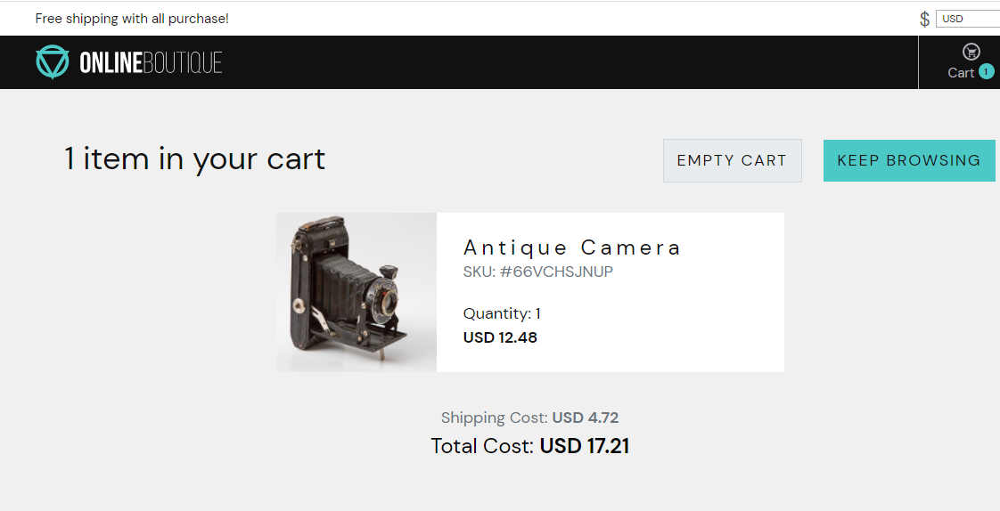

Notes:

- Get a call at 2AM in the morning - customers are mad that they are promised free shipping but not getting it!
- What do we do!

<!--v-->

<!-- .slide: data-background="./civo-fastfeedback/background.png" -->

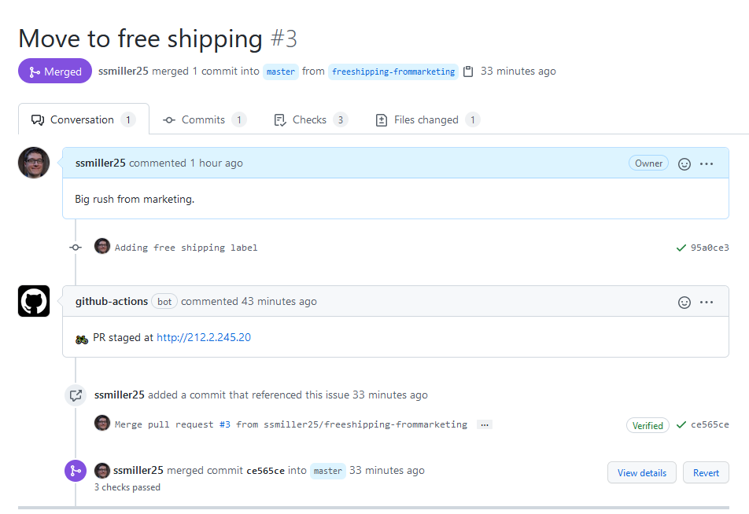

Notes:

- Search through PRs.  See one was merged recently
- Click the "Revert Button

<!--v-->

<!-- .slide: data-background="./civo-fastfeedback/background.png" -->

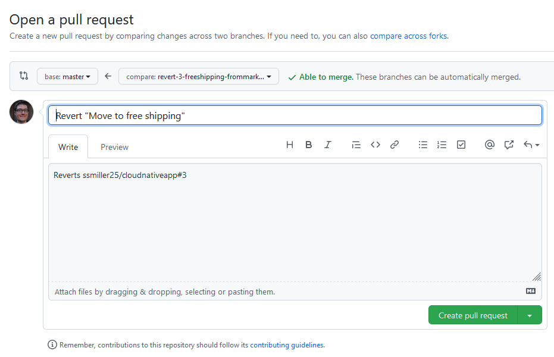

Notes:

- Create a revert PR
- Note, this will go throug the standard PR process.  
  - Organizationally, you'll have to decide if your on-call staff should be able to override PR merge policies to push code!

<!--v-->

<!-- .slide: data-background="./civo-fastfeedback/background.png" -->

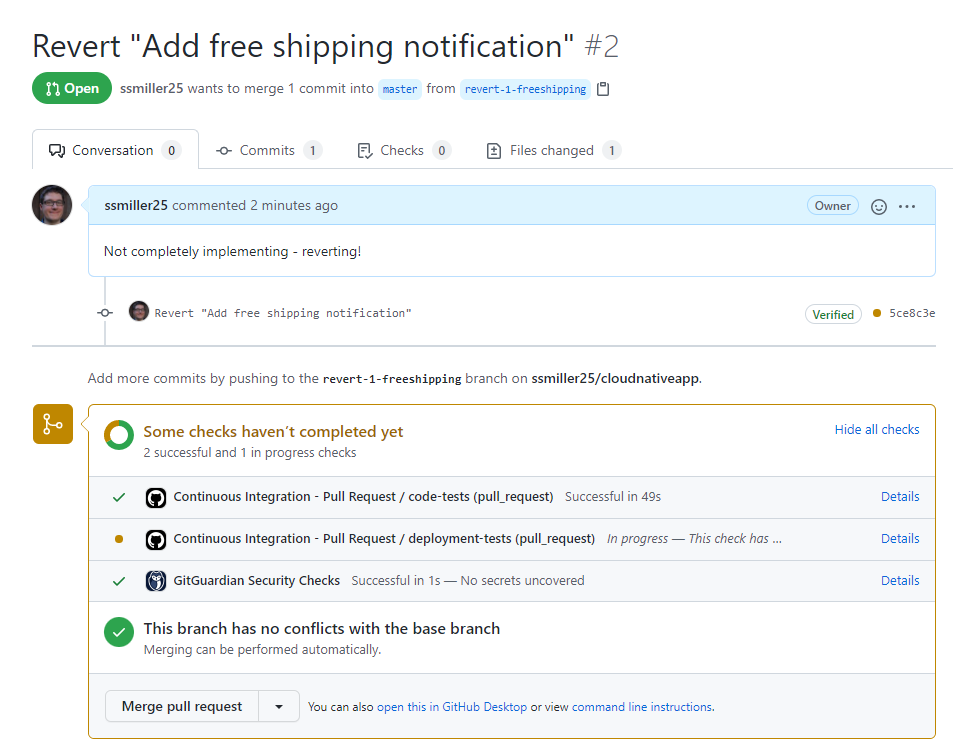 <!-- .element: class="img" style="max-width:600px"-->

Notes:
- In this example, I can merge before the pipeline is finished

<!--v-->

<!-- .slide: data-background="./civo-fastfeedback/background.png" -->

Notes:
- Shipping has been returned to normal

<!--s-->

<!-- .slide: data-background="./civo-fastfeedback/background.png" -->

## Fast Feedback - Conclusion

- Try it out: https://github.com/ssmiller25/cloudnativeapp
  - Issues and PRs welcome
- Presentation: https://present.r15cookie.com/
- On the Civo Community: "Steve Miller"

Notes:

- Try out the demo!  Hopefully will be adding a few new features
  - Refinement of getting started and pipelines
  - Working examples with ServiceMesh and other debugging tools