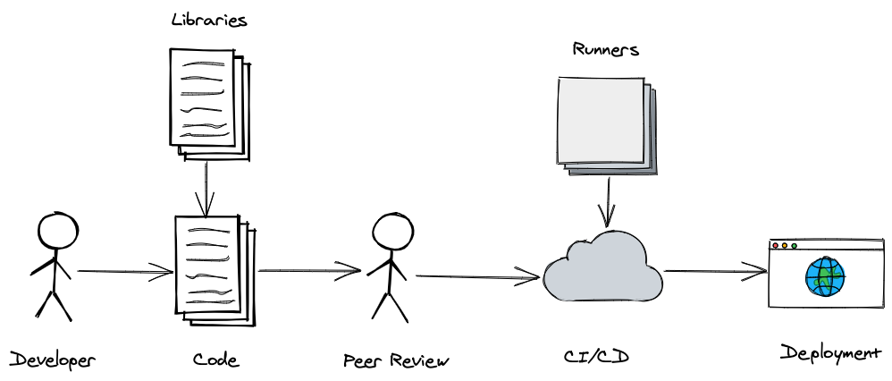

## Defense Against The Dark Arts...of Supply Chain Attacks

 [Steve Miller](https://www.r15cookie.com)

- Devops Practioner
- Sr. DevOps Engineer at Tuition.io

Note:

GOAL: 30 minutes presentation, with 15-30 minute Q&A

- Introduction of myself
  - Sr. DevOps Engineer at Tuition.io
  - Multiple other Devops and System Admin roles across a variety of company sizes as well as public institutions
  - Passion for DevOps Practices, which generally includes CI/CD work.

<!--s-->

## Goal

Demonstrate (software) supply-chain attacks and defense strategies.

- **Log4j**: Library Security
- **left-pad, Faker.js and Color.js**: Library Changes/Removal
- **Solarwinds:** Supply Chain Compromise 

Note:

- Certainly a bit more buzz based on news of recent - and not so recent - events
- Increasing we are seeing security attacks that target more then just production deployments

- Further Reading
  - <https://www.sans.org/blog/what-do-you-need-to-know-about-the-log4j-log4shell-vulnerability/>
  - <https://www.sans.org/blog/what-you-need-to-know-about-the-solarwinds-supply-chain-attack/>
  - <https://www.bleepingcomputer.com/news/security/dev-corrupts-npm-libs-colors-and-faker-breaking-thousands-of-apps/>
  - <https://www.infoworld.com/article/3047177/how-one-yanked-javascript-package-wreaked-havoc.html>

<!--v-->

## Strategy

- Toolbox Mentality
- Focus on Fundamentals

  > “The minute you get away from fundamentals ... the bottom can fall out of your game, your schoolwork, your job, whatever you’re doing.” - Michael Jordon*

Note:

- Focus on small, individual techniques and tools that can be implemented as needed, based on your specific environment
- Focus on fundamentals - a lot of what will protect you best are common coding best practices

- Michael Jordon quote source: <https://www.goodreads.com/quotes/107363-the-minute-you-get-away-from-fundamentals-whether-its>

<!--s-->

## Standard Development Supply Chain

Note:

Supply Chain (Simplified Devops Loop)

             Libs                        Runners
              |                             |
              v                             v
Developer -> Code -> Peer Review -> CI/Tests Deployments -> Production Deployment

Modern supply chains can provide a lot of built in benefits:

- Develop writes and tests code/website on local machine, tests it.
  - May add third party libraries to be more productive
  - May build with third party docker containers
- Pushing code to a central repository
  - CI runs (or not...)
  - Peer reviewed (but let's say not required...)
  - Merged in to main codebase
- Deployment process 
  - Some manual or automated method

Tradition security practices concentrate ont he "Production" deployment/environment
Not uncommon for development shops to consider dev machines/environment not as important to secure as production
As we seen from history, this is a grave mistake.

-  The supply provides a lot of benefits as well.

<!--s-->

## Defending The Supply Chain - Hosts

- Workstations
  - https://www.kolide.com/ 
- Traditionally Managed Servers/Systems
  - Production, Test, and CI/CD Systems
  - https://www.ossec.net

  > "...as a result of a compromise of the Orion software build system and was not present in the source code repository..." - Solarwinds Supply Chain Attack

Note:

- Workstation 
  - Avoid HEAVY handed software solutions
  - Light weight endpoint protection such as Kolide to help with best practices
  - Best Practices - Not pushing directly to test/production
  - Defense in depth should prevent developer compromise from infecting additional systems.  (i.e., a developer should **NOT** directly push code to production without a few )
- Server
  - Again, avoid HEAVY software approaches, but encourage best practices
  - Traditional OS HIDS, File Integrity, and Rootkit detection code
  - Zero Trust Principles, especially with modern work from home environments
  - Main vector of Solarwinds attack.  Bur realize this method is easily adaptable to ANY automated build pipeline, even if your target is not stand-alone Windows executables

Quote Source: <https://www.sans.org/blog/what-you-need-to-know-about-the-solarwinds-supply-chain-attack/>

Detailed Analysis of the Solarwinds Compromise: <https://www.crowdstrike.com/blog/sunspot-malware-technical-analysis/>

<!--s-->

## Defending The Supply Chain - Developer

- Source Control's Branch Protection Rules
  - Prevent Forced Puses (event by adminstrators)
  - Require Pull Requests Review Before Merging

Note:

- Links
  - Protected Branched: <https://docs.github.com/en/repositories/configuring-branches-and-merges-in-your-repository/defining-the-mergeability-of-pull-requests/about-protected-branches#about-branch-protection-settings>
  - Sophisticaed : <https://github.com/Automattic/action-required-review>

- Depending on exact source control system - but all should have this or equivilant features
- Best way to prevent malicious or unintentional security risks in your code
- Peer review requirements/protected branches - should be required.  **No single person should be able to commit code to production
  - Ensure all code has to be reviewed by another developer (or **flag** any emergency commits)
- Security sensitive code may be flagged for additional reviews

<!--s-->

## Defending The Supply Chain - Library

Library Defenses

- **Automated Scanning** for insecure versions
- **Version Pinning** to prevent breaking updates (**MUST** be combined with automated scanning)
- **Artifact Vendoring** to prevent removal from public repositories effecting builds.

Note:

- Target both malicious and inadvertent security concerns
- Third party library - ensure scanning
  - They are well known, well used, signed (both library and docker)
- Version Pinning
  - Heavily depending on language, but versioning your package lock file, such as:
    - packages-lock.json for Javascript
    - Gemfile.lock for Ruby
    - composer.lock for PHP projects (that use composer...which they should)
- Artifact Vendoring (Advance)
  - CAREFUL...should not blindly version-control your dependent modules directories!  
  - Simple: Leverage Caching to prevent momentary library outages: https://github.com/actions/cache

<!--v-->

## Defending The Supply Chain - Dependabot Alternatives

- Synk
- Whitesource Renovate
- SonarQube and Qualys

<!--s-->

## Defending The Supply Chain - Docker

Docker Defenses (similar to library)

- **Automated Scanning**
- **Version Pinning** - SHA256 Hash of Upstream
- **Artifact Vendoring** - Cache remote base images and any dependent artifacts needed for build

Note:

- Repository Security
  - Good practices on employee access to repositories
  - Ensure CI and CD check signatures, and potentially require additional approval for third party libraries
- Similar to library defences.  Some differences
  - Dockerfile updates also share OS level concerns (potentially)
  - Pin dockerfile to SHA256 hash
  - BUT - need method to ensure you are on latest
  - Updates within Dockerfile..
  - Ensure dockerfile scan, but in CI as well as deployed artifact

<!--v-->

## Defending The Supply Chain - Continuous Monitoring

Note:

- How to we defend again older libraries (log4j...)
  - Dependabot like auto updates
  - Ideally PRs automatically created and assigned for integration.
  - Potential notification based on severity of updated code...
- How to defend against library modification <https://fossbytes.com/developer-corrupts-faker-js-and-color-js/>

<!--s-->

## Defending the Supply Chain - Conclusion

- Take small steps at a time
- Assemble your own toolkits
- Constant innovation

<!--s-->
## Thanks you!

- me@r15cookie.com
- https://www.r15cookie.com

### Repos

- <https://github.com/ssmiller25/brokencrystals> (React/Node)
- <https://github.com/ssmiller25/diwa> (PHP)

<!--s-->

## Additional Resources

- OWASP Vulerable Web Application Directory Project: <https://github.com/OWASP/OWASP-VWAD>